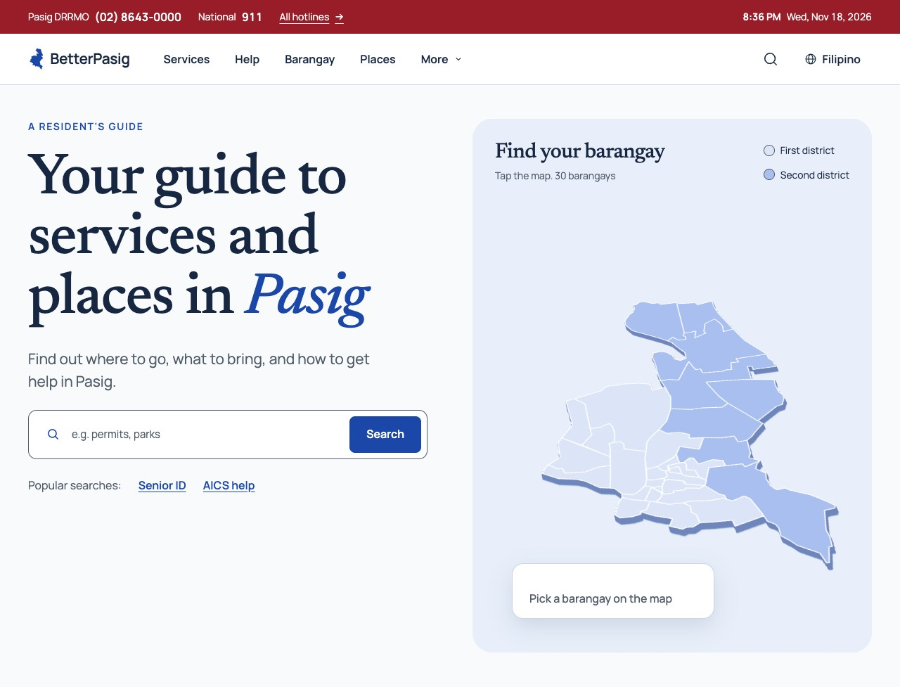

<p align="center"></p>

<h1 align="center">BetterPasig.org</h1>

<p align="center">Gabay sa mga serbisyo, benepisyo, at lugar sa Pasig.<br>
A resident's guide to services, benefits, and places in Pasig.</p>

<p align="center"><a href="https://betterpasig.org/">Visit BetterPasig.org</a> · <a href="https://betterpasig.org/fil/" lang="fil">Filipino</a> · <a href="#how-to-contribute">Contribute</a></p>

<p align="center"><a href="https://betterpasig.org/"></a></p>

BetterPasig is a volunteer-run, nonpartisan civic guide for Pasig City and part of [BetterGov.ph](https://bettergov.ph/). Find [service requirements](https://betterpasig.org/serbisyo/), [benefits and assistance](https://betterpasig.org/tulong/), [barangay information](https://betterpasig.org/barangay/), [emergency contacts](https://betterpasig.org/emergency/), and [places to visit](https://betterpasig.org/pasyalan/). The guide links to its sources and leaves out information that still needs verification.

> Hindi ito opisyal na website ng Lungsod ng Pasig. For official transactions, go to [pasigcity.gov.ph](https://pasigcity.gov.ph/).

## How to contribute

- **Report something wrong or missing.** [Open an issue](https://github.com/kuya-egg/betterpasig/issues/new) with the page link and what needs changing. Include a public source if you have one. No coding needed.
- **Help verify barangay information, improve Filipino or English copy, or fix the site.** See [CONTRIBUTING.md](CONTRIBUTING.md) for the steps and source requirements.

Open pull requests against **`dev`**. Maintainers promote `dev` to **`main`**, which deploys to BetterPasig.org through Cloudflare Pages.

## Quick start

Install [Node.js](https://nodejs.org/) at the version in [`.node-version`](.node-version) and [Bun](https://bun.sh/) at the version in [`package.json`](package.json).

```bash
bun install --frozen-lockfile
bun run dev       # http://localhost:4321
```

To try search locally, run `bun run build` and then `bun run preview`. Pagefind builds the search index into `dist/`; `bun run dev` does not generate it.

## What's in this repo

| Folder | What it holds |
| --- | --- |
| [`src/`](src/) | Astro pages and components, shared styles, and translations. English is at `/`. Filipino is at `/fil/`, and Cebuano, Ilokano, Hiligaynon, Waray, Bikol, and Kapampangan are at `/ceb/`, `/ilo/`, `/hil/`, `/war/`, `/bcl/`, and `/pam/`. Those six reuse Filipino content. |
| [`data/`](data/) | Sourced JSON for services, benefits, barangays, officials, hotlines, and places. See the [data guide](data/README.md). |
| [`design/`](design/) | Design tokens, logo assets, map geometry, and screenshots. |
| [`docs/`](docs/) | [Roadmap](docs/roadmap.md), [backlog](docs/backlog.md), and [design system](docs/design-system.md). |
| [`scripts/`](scripts/) | [Data, browser, and build checks](scripts/README.md), plus asset generators. |
| [`prototype/`](prototype/) and [`video/`](video/) | Earlier prototypes and launch video assets. |

## Credits and licenses

- Barangay boundaries: PSA PSGC via [faeldon/philippines-json-maps](https://github.com/faeldon/philippines-json-maps) (MIT). The logo is our own drawing of that outline; we do not use the official city seal.
- Service data: Pasig City Citizen's Charters 2025 (`assets.pasigcity.gov.ph`).
- Typefaces: [Newsreader](https://github.com/productiontype/Newsreader) and [Manrope](https://github.com/sharanda/manrope) (SIL Open Font License), self-hosted. The logo lockups use Geist (SIL Open Font License).
- Photographs: credited to their authors with license details on the [photo credits page](https://betterpasig.org/larawan/).
- Launch video music and sound effects are synthesized in code; the voice is Microsoft Edge neural TTS (fil-PH-AngeloNeural).
