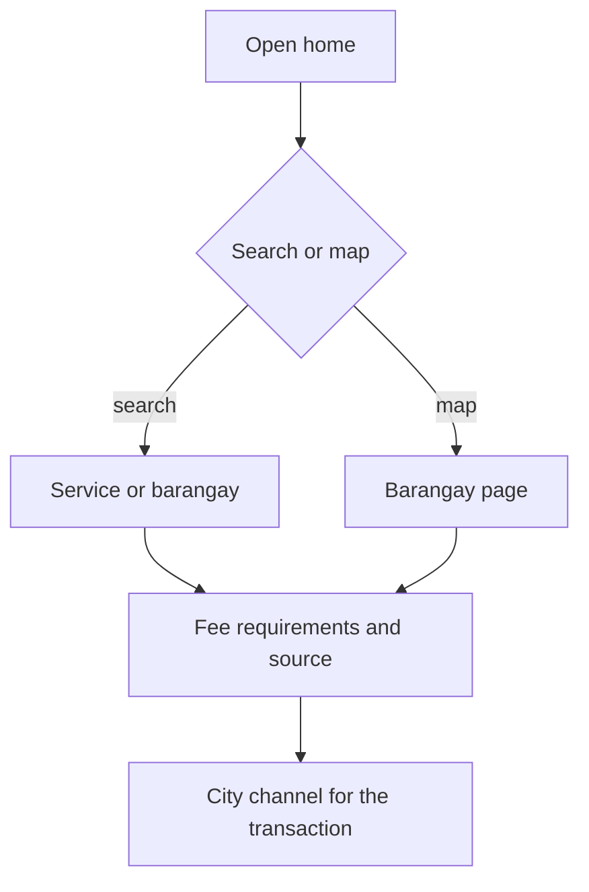

# Product Requirements Document (PRD)

**Project:** BetterPasig
**Date:** 2026-10-22
**Version:** 0.1
**Owner:** BetterPasig maintainers
**Status:** Draft
**Last reconciled:** N/A
**BRD:** N/A. No business-requirements doc. The why lives in [roadmap.md](roadmap.md).

---

## 1. Product Purpose & Value Proposition

BetterPasig is the place a Pasigueño opens to find a city service, benefit, opportunity, or official, in Filipino or English, with the office, the fee, the requirements, and the source on one page. Pasig already publishes this in long PDFs and scattered posts. The site organizes it and sends every payment, application, and complaint to the city's own channels. It is not the official website of Pasig City.

---

## 2. Target Personas

**Primary: Pasigueño resident**: Any age, often on a budget phone. Pain: the right office, fee, or hotline is buried in a charter PDF or a Facebook post that has scrolled away. Success: they find the office, the fee, and the requirements in under 60 seconds and know where to go next.

**Secondary: Barangay steward**: A volunteer for one barangay. Pain: hall numbers and official names go stale. Success: they confirm their barangay, update the JSON with the date they checked, and the page shows that date.

---

## 3. Core Features & Priorities

IDs are permanent. Priority is MoSCoW.

| ID | Feature | Description | Priority |
|----|---------|-------------|----------|
| PRD-F1 | Sourced services | All 173 Citizen's Charter services, each with office, fee, processing time, requirements, and a source URL | Must-Have |
| PRD-F2 | Verified contacts | Emergency hotlines and all 30 barangay pages confirmed, dated, and re-checked every 90 days. Unconfirmed facts show "Sinusuri pa" | Must-Have |
| PRD-F3 | Find it in a minute | In a test of 30 residents, 10 of them seniors, 8 in 10 find the office, fee, and requirements in under 60 seconds | Must-Have |
| PRD-F4 | Trust rules | English is the default, with a full Filipino twin under `/fil/`. Every fact cites a trusted source: official (`*.gov.ph`/`*.gov`, an official government account, an agency's own system, an institution's own site for its own facts) or a major news outlet. Never Wikipedia, directories, aggregators or blogs (D7). A fact without one is removed or `null`. Not-official disclaimer on every page. Officials listed equally. No accounts, no stored complaints, no tracking cookies. No party colors or endorsements | Must-Have |
| PRD-F5 | This week in Pasig | Weekly list of payouts, scholarships, job fairs, and deadlines, with an archive | Should-Have |
| PRD-F6 | Follow the city | Bids log and a New City Hall page updated monthly | Should-Have |
| PRD-F7 | Search | Pagefind across services, barangays, officials, and programs, plus Filipino synonyms | Should-Have |
| PRD-F8 | Later public records | Budget explorer, COA summaries, ordinance search, flood readiness, and a neutral 2028 election guide | Won't-Have (v1) |

---

## 4. User Stories & Acceptance Criteria

**US-01: Read a service** (PRD-F1)

> As a resident, I want one page per city service so that I can see the fee, the time, the requirements, and where the fact came from.

- Given a service in `data/services.json` with a source, when I open its page, then I see the office, fee, processing time, requirements, source, and the date the source was checked.
- Given a service with a null fee, when I open its page, then the fee is omitted and the page does not invent a number.

**US-02: Call the right number** (PRD-F2)

> As a resident, I want a dated hotline and my barangay hall so that I do not call a stale number.

- Given a hotline with `verify` false and a checked date, when I view it, then I see the number and the date.
- Given a contact that has not been confirmed, when I view it, then I see "Sinusuri pa" and the page does not present the number as confirmed.

**US-03: Finish in a minute** (PRD-F3)

> As a resident, including a senior, I want the answer on the first screen I understand so that I can act the same day.

- Given the moderated test of 30 residents, 10 of them seniors, when each is asked for an office, a fee, and the requirements, then at least 24 finish in under 60 seconds before public launch.

**US-04: Trust the page** (PRD-F4)

> As a resident, I want to know this is a guide, not the city, and that the site is not keeping a file on me.

- Given any page, when it loads, then it shows that this is not the official Pasig website and links official transactions to pasigcity.gov.ph.
- Given the officials directory, when it renders, then each person gets the same card size and the same sort rule.
- Given the site, when a change adds an account, a stored complaint, or a tracking cookie, then that change is rejected.

**US-05: English when I need it** (PRD-F4)

> As a resident who reads Filipino, I want the same facts under `/fil/` while English stays the default.

- Given a page with `_fil` fields, when I open the Filipino path, then the facts match the English page and the English URL stays the default.

---

## 5. App Flow & UX Intent

**Design reference:** [design-system.md](design-system.md) and `design/tokens/`. There is no separate design-system artifact.

### 5.1 Screen Inventory

The site is static. "Loading" is the barangay-map loader, skipped when the visitor asks for reduced motion. A missing source is a build failure, not an error banner that invents the fact.

| Screen | Purpose | Entry points | States to design |
|--------|---------|--------------|------------------|
| Home | Search, emergency numbers, map, featured services | `/`, `/fil/` | empty search, map loader, data error, success |
| Service | One charter service | `/serbisyo/[id]` | null fee hidden, build fails without a source, success with source and date |
| Service index | 12 categories | `/serbisyo` | empty category, success |
| Barangay | Hall, phones, officials | `/barangay/[id]` | "Sinusuri pa", success with checked date |
| Officials | City, council, offices, 30 barangays | `/opisyal` | equal cards, success |
| This week | Opportunities | `/ngayong-linggo` | empty week, success |
| Bids | Procurement log | `/bids` | empty log, success |
| New City Hall | Monthly note | `/bagong-city-hall` | stale past a month, success |
| Corrections | Public fix log | linked from the footer | empty log, success |

### 5.2 Navigation Model & Information Architecture

**Primary navigation pattern:** a header on every page. English is the default. Filipino lives under `/fil/`. There is no account menu and no login.

| Destination | Maps to screen (§5.1) | Route / path | Auth required | Feature(s) |
|-------------|-----------------------|--------------|---------------|------------|
| Home | Home | `/` and `/fil/` | No | PRD-F2, PRD-F3, PRD-F4 |
| Services | Service index, Service | `/serbisyo`, `/serbisyo/[id]` | No | PRD-F1 |
| Barangay | Barangay | `/barangay/[id]` | No | PRD-F2 |
| Officials | Officials | `/opisyal` | No | PRD-F4 |
| This week | This week | `/ngayong-linggo` | No | PRD-F5 |
| Bids | Bids | `/bids` | No | PRD-F6 |
| New City Hall | New City Hall | `/bagong-city-hall` | No | PRD-F6 |

```
/                         English home
/fil/                     Filipino home
/serbisyo                 category index
/serbisyo/[id]            one service
/barangay/[id]            one barangay
/opisyal                  officials
/ngayong-linggo           weekly list
/bids                     bids log
/bagong-city-hall         city hall note
```

**Global elements, auth boundaries, deep links:** header, emergency strip, footer with the not-official line and a corrections link. Every route is public. No path requires a session.

### 5.3 App Flow

**Linear (primary path):** `Home, search or map, service or barangay, source and next step, city channel`



**Annotations:** entry is the home page or a shared link. The branch is search versus the map. There is no account dead end. Leaving for the city website is success, not abandonment. Edge cases: a null fee stays blank, an unconfirmed number shows "Sinusuri pa", reduced motion skips the map loader, and a missing source fails the build.

### 5.4 Onboarding Flow

Aha moment: the office, fee, and requirements on one sourced page. Time-to-first-value: under 60 seconds. Skippable/resumable: there is no tour and no signup. Signup friction budget: no account fields.

### 5.5 UX Constraints

- English and Filipino, 17px body, one accent color, tables for fees and times.
- Works on a budget phone. First load under 300 KB. Tap targets at least 48px.
- Emergency numbers are visible without scrolling. Red is emergency only. Amber is "Sinusuri pa" only.
- Motion is short and off when the visitor prefers reduced motion.

### 5.6 Instrumentation & Event Taxonomy

No business-metrics sheet exists, so there is no metric id from one. These two events feed the roadmap's visitor count and empty-search count. No personal data in properties.

| Event name | Fires when | Key properties | Feeds metric |
|------------|-----------|----------------|--------------|
| page_viewed | A page is served | path, language. No name, no account id | Monthly unique visitors |
| search_empty | A search returns nothing | term only. No IP | Empty-search count |

**Naming convention:** snake_case, past tense. **Analytics tool:** Cloudflare Web Analytics, cookieless, not connected yet. The empty-search counter is a later Worker and does not exist today.

---

## 6. Out of Scope for This Release

- Budget explorer, COA summaries, ordinance search, and flood maps. Deferred to 2027.
- Neutral May 2028 election guide. Deferred until that cycle.
- Accounts, stored complaints, tracking cookies, and any form that keeps personal data.

---

## 7. AI / Agent Feature Specifications

No AI component ships in the product. This section does not apply. Agents may help write the site. They are not a feature of the site.

---

## 8. Dependencies & Assumptions

- **Dependencies:** Pasig Citizen's Charters and the other public sources already cited in `data/`. Astro, Cloudflare Pages, the domain betterpasig.org.
- **Assumptions:** directory barangay facts stay labeled unconfirmed until a steward checks them (state A1). One shared project with the existing BetterLGU listing is still open (state A2).

---

## 9. Implementation Plan

| # | Phase / Milestone | Entry criteria | Exit criteria (Definition of Done) | Owner (DRI) | Top risk |
|---|-------------------|----------------|-------------------------------------|-------------|----------|
| M1 | Specify | Roadmap and this Draft | A maintainer pull request locks this PRD, or corrects it first | BetterPasig maintainers | Scope creeps into PRD-F8 |
| M2 | Shape | PRD locked | Pages and tokens match the design system | Tech lead | A second, drifting design doc |
| M3 | Implement | Shape done for the slice | PRD-F1 through PRD-F4 acceptance criteria pass locally | Tech lead for the site, content lead for service copy, stewards for their own contacts | Unsourced facts merge |
| M4 | Verify | Feature-complete for the Must-Haves | QAD release criteria met, including the resident test | Design and accessibility | The test is skipped under time pressure |
| M5 | Release | QA passed | Public site on 15 Dec 2026, disclaimer visible, rollback rehearsed once | BetterPasig maintainers | A wrong hotline is live |
| M6 | Operate | Released | 48-hour corrections and a 30-day visitor check | Stewards for their barangay. Any maintainer for a fact in the lane they took | Facts go stale after launch |

**Rollout strategy:** soft launch to volunteers on 1 Dec 2026, then one public cutover on 15 Dec 2026, because there are no accounts to migrate.

**Rollback plan (single source; OPS and BUILD point here):**

- *Trigger criteria:* the homepage does not load, or a live page states a fee or hotline that fails its source check.
- *Revert mechanism:* redeploy the previous Cloudflare Pages deployment. Content mistakes also revert the JSON commit.

**RFC cross-reference:** N/A

---

## Self-Check

- [x] §3/§4: every Must-Have has a permanent `PRD-F#` and a US-# story with testable Given/When/Then criteria
- [x] §5.1 to §5.3: every interactive screen has all four states, every destination a route and auth rule, no unintended dead ends
- [x] §5.6: no BRD metrics exist. The two events feed the roadmap measures
- [x] §7 skipped. No AI component ships
- [x] §9 runs through Post-launch with entry, exit, and one DRI per milestone; rollback has a trigger and one revert mechanism
- [x] §6 names the cuts
