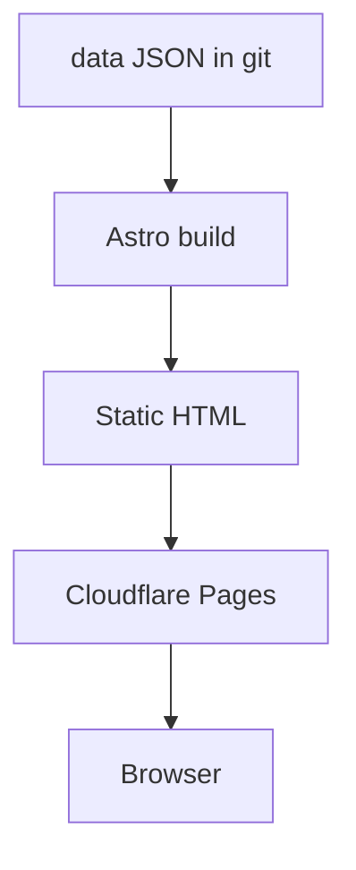

# System Design Document (SDD)

**Project:** BetterPasig
**Date:** 2026-10-22
**Version:** 0.1
**Owner:** BetterPasig maintainers
**Status:** Draft
**Last reconciled:** N/A
**PRD:** [prd-betterpasig.md](prd-betterpasig.md)

---

## 1. Architectural Vision & Principles

**Architecture style:** static site. Astro reads JSON in git and emits HTML. Cloudflare Pages serves that HTML.

**Guiding principles:** the JSON file is the fact. A page does not invent a missing field. There is no account system to secure because there is no account system.

**Key trade-offs and known V1 debt:** no database, so a correction is a pull request, not an admin screen. Content collections and Zod are still a backlog item. Today `src/lib/data.ts` imports the JSON directly. The empty-search Worker is not built.

---

## 2. High-Level Architecture

| Layer | Technology | Responsibility |
|-------|------------|----------------|
| Client | Browser, HTML and CSS | Read, search later, copy a hotline. No account |
| API / Gateway | None in v1 | Pages are files. A later Worker may count empty-search terms only |
| Service / Compute | Astro 7 at build time | Turn `data/*.json` into pages |
| Data | JSON files in git | Services, hotlines, barangays, officials, programs |
| Infrastructure | Cloudflare Pages | Host `dist/`. Rollback is the previous deployment |

**Must-Have trace:**

| PRD-F# | Component(s) | Tables / endpoints |
|--------|--------------|--------------------|
| PRD-F1 | `data/services.json`, service page | GET `/serbisyo/[id]` |
| PRD-F2 | `data/hotlines.json`, `data/barangays.json`, home and barangay page | GET `/`, GET `/barangay/[id]` |
| PRD-F3 | Home search and service page | GET `/` |
| PRD-F4 | Layout disclaimer, officials page, no user store | GET `/opisyal` |

---

## 3. Data Architecture

**Primary database:** none. Content is JSON in the repo, because the site is a publication, not an app with user rows. **Cache:** Cloudflare's CDN for HTML. **Vector store:** N/A.

There is no relational schema and no migration. Bullets only.

**Content files:**

| File | Holds | PRD |
|------|-------|-----|
| `data/services.json` | 173 services, offices, categories. `sources` required. Unknowns are `null` | PRD-F1 |
| `data/hotlines.json` | Numbers, `sources`, `verify`, retrieved date | PRD-F2 |
| `data/barangays.json` | 30 barangays | PRD-F2 |
| `data/officials-directory.json` | Officials, equal listing | PRD-F4 |
| `data/site.json` | Which hotlines and services the home page features | PRD-F3 |

**Relationships:** a service points at an office id and a category id. `site.json` points at hotline and service ids. `src/lib/data.ts` throws if a featured id is missing.

**Indexes:** none in a database. Pagefind is the later search index (PRD-F7). **Caching:** CDN cache of static files.

**Migration strategy:** edit JSON in a pull request. Rollback is `git revert` plus a Pages redeploy. Do not add a database to make edits easier.

---

## 4. API Design & External Integrations

**API style:** no application API. **Contract source:** the routes below are static GET pages.

| Method | Path | Purpose |
|--------|------|---------|
| GET | `/serbisyo/[id]` | One service (PRD-F1) |
| GET | `/barangay/[id]` | One barangay (PRD-F2) |
| GET | `/opisyal` | Officials directory (PRD-F4) |

`GET /serbisyo/[id]` · PRD-F1

Request: none. A browser asks for the path. The id is the service id in `data/services.json`.

Response 200: HTML with the office, fee, processing time, requirements, source, and checked date. A missing source fails the build, so there is no page to return.

N/A: single-hop. The browser requests a file. Pages returns HTML. No service calls another service.

**External integrations:**

| Service | Purpose | Rate limits / fallback |
|---------|---------|------------------------|
| pasigcity.gov.ph and charter PDFs | Source links the visitor opens | If a source URL dies, the page keeps the stored fact and the checked date, and a correction updates the JSON. The build does not scrape the city site |
| Cloudflare Pages | Hosting | If a deploy is bad, redeploy the previous deployment (PRD §9) |
| Cloudflare Web Analytics | Cookieless visitor counts, not connected yet | If it never connects, the visitor metric stays unknown. Do not add a cookie tool to fill the gap |

---

## 5. Security & Authorization

- **Authentication:** none. **Session:** none. A barangay picker may use localStorage on the device only. It is not sent to a server.
- **Authorization model:** everyone can read every page. There is no private object. A pull request is the only write, and a person reviews it.
- **PII at rest:** no resident PII. Public-official names are copied from public directories. **Secrets:** none in the repo. A Cloudflare token stays in the deployer's own environment. **Input validation:** featured ids are checked in `src/lib/data.ts`. Zod on content collections is the planned build failure for a missing `sources` array (PRD-F1).

---

## 6. Infrastructure, CI/CD & Deployment

- **Hosting:** Cloudflare Pages project `betterpasig`, output `dist/`, see `wrangler.toml`. **Environments:** local `bun run dev`. Preview deploys are planned and not connected. Production is `main` at launch.
- **CI/CD:** not set up. Local check is `bun run check`. A deploy is `bun run build` then Pages.
- **Backup & DR:** git is the content store. Cadence is every merged commit. **RTO** 30 minutes once Pages is connected, by redeploying the previous deployment. **RPO** the last merged commit. Restore tested: not yet. The first release rehearsal is part of milestone M5.

---

## 7. Non-Functional Requirements

| Requirement | Target | Notes |
|-------------|--------|-------|
| First load | under 300 KB | Roadmap guardrail. Not enforced in CI yet |
| Find time | under 60 seconds for 80% of the resident test | PRD-F3. Design and accessibility runs the test |
| Uptime | homepage returns 200 after each deploy | No uptime monitor is wired. Whoever deployed checks after the deploy |
| Max concurrent users V1 | CDN capacity | No app server |
| Data retention | sourced public facts stay until a sourced edit replaces them | No resident record to delete. Analytics, when connected, stay cookieless |

---

## 8. AI / Agent Architecture

No AI component ships. This section does not apply. Nothing in the product sends visitor text to a model.

---

## Self-Check

- [x] Every Must-Have `PRD-F#` maps to a §2 component
- [x] §2 has a diagram. §3 has no database tables, so there is nothing to migrate
- [x] Bullets only for content files. §4.1 is N/A: single-hop
- [x] Each external integration has a fallback. §5 covers the absence of auth, secrets, and the validation that exists
- [x] §6 states RTO and RPO. Restore is not tested yet and says so
- [x] §7 targets are numbers
- [x] No AI section to fill
